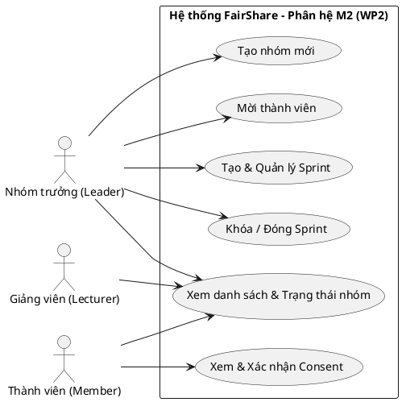
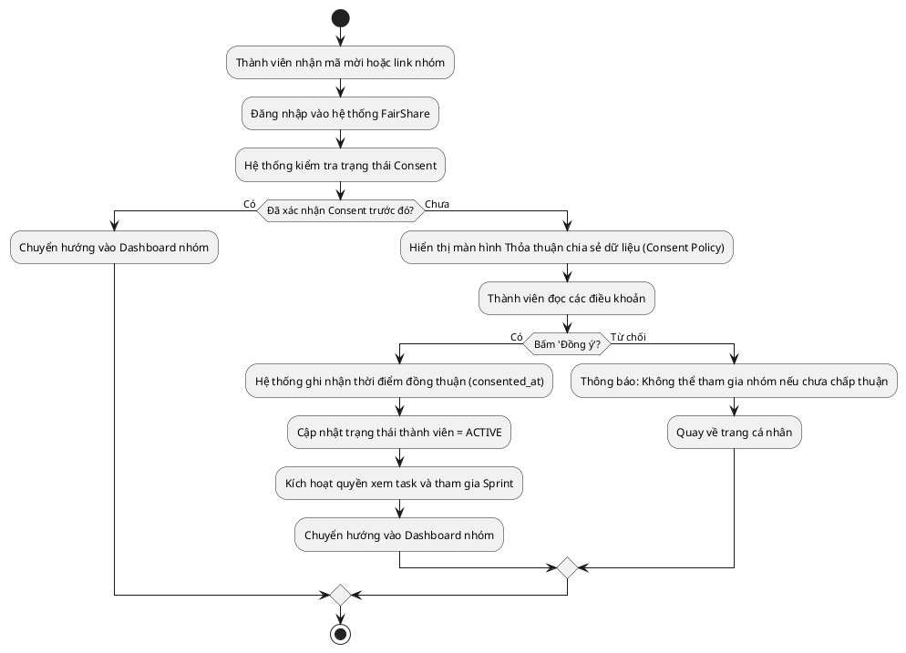
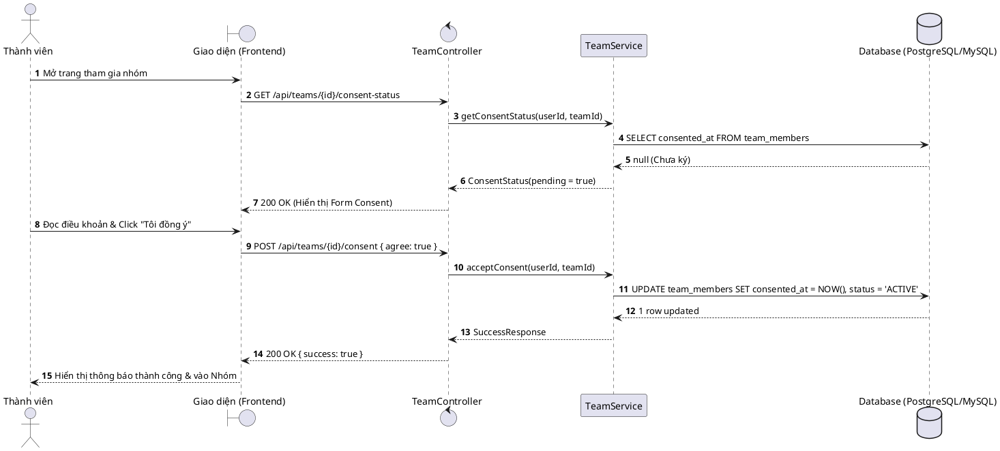

# TÀI LIỆU YÊU CẦU & THIẾT KẾ USE CASE / DIAGRAMS (PHÂN HỆ M2)
**Phân hệ:** WP2 – Quản lý Nhóm, Sprint & Consent  
**Dự án:** FairShare (Quản lý dự án CNTT – UEH)  
**Tác giả (PM mini/BA):** Hà Ngọc Thiện  

---

## 1. DANH SÁCH YÊU CẦU (REQUIREMENTS SPECIFICATION)

### 1.1. Yêu cầu chức năng (Functional Requirements - FR)
| Mã FR | Tên chức năng | Mô tả chi tiết | Tác nhân (Actor) | Độ ưu tiên |
|---|---|---|---|---|
| **FR-M2-01** | Tạo nhóm (Create Team) | Nhóm trưởng tạo nhóm mới, đặt tên dự án, mô tả và chọn môn học. | Nhóm trưởng (Leader) | Bắt buộc (Must-have) |
| **FR-M2-02** | Mời thành viên (Invite Member) | Gửi lời mời qua email hoặc tạo mã mời (Invite Code) cho 5 thành viên còn lại. | Nhóm trưởng | Bắt buộc |
| **FR-M2-03** | Xác nhận Consent (Data Consent) | Thành viên đọc chính sách chia sẻ dữ liệu và bấm "Đồng ý" để được kích hoạt tham gia. | Thành viên (Member) | Bắt buộc |
| **FR-M2-04** | Quản lý thành viên | Xem danh sách thành viên, vai trò (Leader/Member) và trạng thái Consent (Pending / Accepted). | Cả nhóm | Bắt buộc |
| **FR-M2-05** | Thiết lập Sprint (Create Sprint) | Định nghĩa tên Sprint (ví dụ: Sprint 1), ngày bắt đầu, ngày kết thúc và mục tiêu sprint. | Nhóm trưởng | Bắt buộc |
| **FR-M2-06** | Đóng Sprint (Close Sprint) | Chuyển trạng thái Sprint từ `ACTIVE` sang `COMPLETED`, kích hoạt cổng chấm chéo của M4. | Nhóm trưởng / Hệ thống | Bắt buộc |

### 1.2. Yêu cầu phi chức năng (Non-Functional Requirements - NFR)
* **NFR-SEC (Bảo mật & Riêng tư):** Chỉ các thành viên đã chấp thuận Consent mới được hệ thống đồng bộ dữ liệu hoạt động.
* **NFR-PERF (Hiệu năng):** API lấy thông tin nhóm và danh sách thành viên phản hồi dưới 500ms.
* **NFR-USAB (Khả năng sử dụng):** Quy trình đọc và ký Consent gói gọn trong 1 màn hình đơn giản, thao tác hoàn thành dưới 15 giây.

---

## 2. USE CASE DIAGRAM (SƠ ĐỒ TRƯỜNG HỢP SỬ DỤNG)

### Mã sơ đồ PlantUML (Dùng để import vào Enterprise Architect):


---

## 3. ACTIVITY DIAGRAM (SƠ ĐỒ HOẠT ĐỘNG: GIA NHẬP NHÓM & KÝ CONSENT)

### Mã sơ đồ PlantUML (Cho Enterprise Architect):


---

## 4. SEQUENCE DIAGRAM (SƠ ĐỒ TRÌNH TỰ: XÁC NHẬN CONSENT)

### Mã sơ đồ PlantUML (Cho Enterprise Architect):


---

## 5. THIẾT KẾ CSDL DỰ KIẾN CHO PHÂN HỆ M2

```sql
-- Bảng teams: Thông tin nhóm
CREATE TABLE teams (
    id BIGINT PRIMARY KEY AUTO_INCREMENT,
    name VARCHAR(100) NOT NULL,
    description TEXT,
    course_name VARCHAR(100),
    owner_id BIGINT NOT NULL,
    invite_code VARCHAR(20) UNIQUE,
    created_at TIMESTAMP DEFAULT CURRENT_TIMESTAMP
);

-- Bảng team_members: Thành viên và cờ Consent
CREATE TABLE team_members (
    id BIGINT PRIMARY KEY AUTO_INCREMENT,
    team_id BIGINT NOT NULL,
    user_id BIGINT NOT NULL,
    role VARCHAR(20) DEFAULT 'MEMBER', -- LEADER / MEMBER
    status VARCHAR(20) DEFAULT 'PENDING_CONSENT', -- PENDING_CONSENT / ACTIVE
    consented_at TIMESTAMP NULL,
    joined_at TIMESTAMP DEFAULT CURRENT_TIMESTAMP,
    CONSTRAINT fk_tm_team FOREIGN KEY (team_id) REFERENCES teams(id),
    UNIQUE KEY uq_team_user (team_id, user_id)
);

-- Bảng sprints: Chu kỳ sprint
CREATE TABLE sprints (
    id BIGINT PRIMARY KEY AUTO_INCREMENT,
    team_id BIGINT NOT NULL,
    sprint_name VARCHAR(50) NOT NULL,
    start_date DATE NOT NULL,
    end_date DATE NOT NULL,
    goal TEXT,
    status VARCHAR(20) DEFAULT 'PLANNING', -- PLANNING / ACTIVE / COMPLETED
    created_at TIMESTAMP DEFAULT CURRENT_TIMESTAMP,
    CONSTRAINT fk_sprint_team FOREIGN KEY (team_id) REFERENCES teams(id)
);
```
