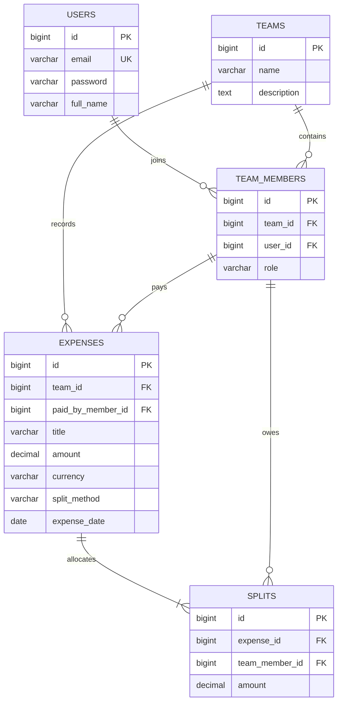

# FairShare database ERD

The existing `teams` and `team_members` tables represent the Group and Member
concepts in the M4 checklist. They are reused rather than introducing duplicate
Group/Member tables.

Database constraints prevent duplicate team membership and duplicate member
allocations for one expense. `SplitService` also verifies that all participants
belong to the expense team and that their allocated amounts add up exactly to
the expense amount.
