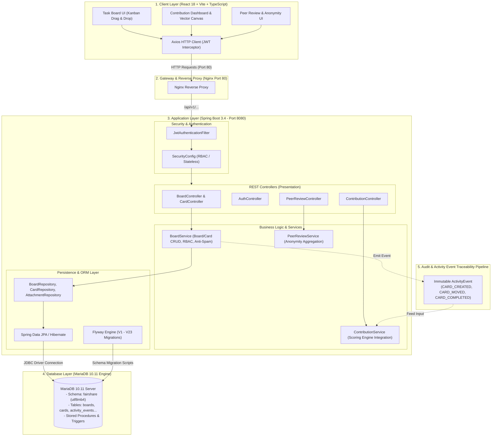
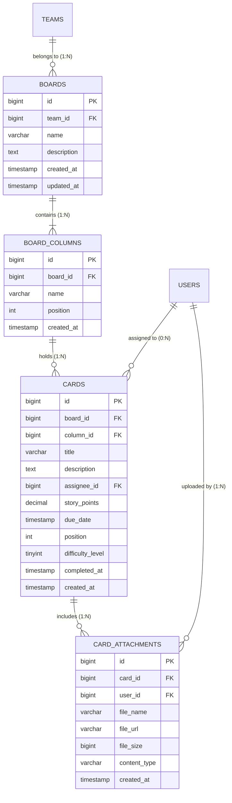
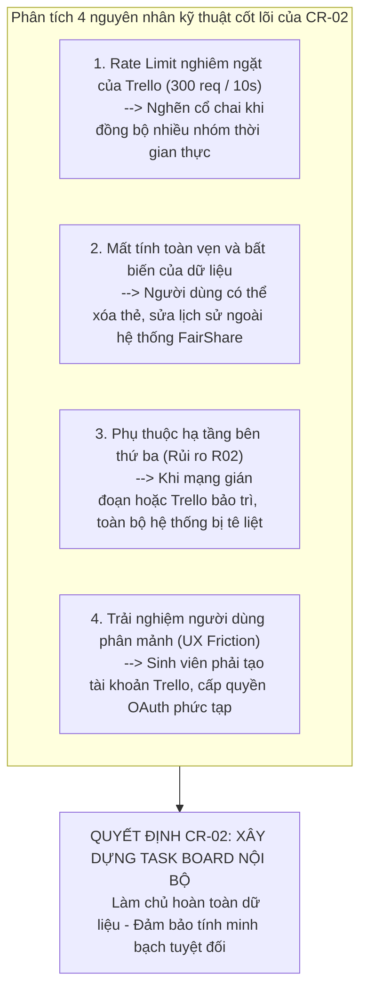
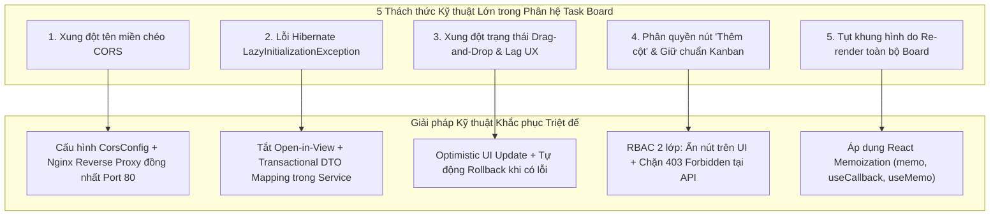

# CHƯƠNG: KIẾN TRÚC HỆ THỐNG VÀ PHÂN HỆ TASK BOARD NỘI BỘ (BẢN HOÀN CHỈNH)

**Học phần:** Quản lý dự án Công nghệ Thông tin – Đại học Kinh tế TP.HCM (UEH)  
**Giảng viên hướng dẫn:** TS. Nguyễn Mạnh Tuấn  
**Dự án:** FairShare – Nền tảng đo lường & minh bạch hóa mức đóng góp đồ án nhóm sinh viên  
**Người thực hiện:** M1 – Nguyễn Phúc Vương (MSSV: 31241025017), Backend & Core Platform Lead, WP1  
**Ngày hoàn thiện:** 17/11/2026 (Sprint 6) | Nộp cho Leader M0 tổng hợp Báo cáo bản 1  
**Tài liệu tham chiếu & Mã nguồn:** `docs/CR02-Internal-Board-Module.md`, `docs/qa/defect-log.md`, `fairshare-backend/src/main/java/com/fairshare/board/`, `frontend/src/features/board/BoardView.tsx`

---

## 1. Kiến trúc phân tầng hệ thống (Multi-Tier Layered Architecture)

### 1.1 Triết lý thiết kế & Tổng quan kiến trúc
Hệ thống **FairShare** được thiết kế theo mô hình **Kiến trúc phân tầng (Layered Architecture)** kết hợp với phong cách **Micro-modular Monolith**, đóng gói và triển khai đồng bộ qua **Docker Compose**. Mô hình này giải quyết triệt để bài toán phân tách trách nhiệm (Separation of Concerns - SoC), đảm bảo tính độc lập giữa tầng giao diện, tầng xử lý nghiệp vụ và tầng lưu trữ dữ liệu, tạo điều kiện thuận lợi cho việc kiểm thử tự động (Unit Test, Integration Test, Regression Test) và bảo trì lâu dài.

Toàn bộ hệ thống được phân rã thành 5 phân tầng kỹ thuật mạch lạc:

*Bảng 1.1: Trách nhiệm và công nghệ các phân tầng trong hệ thống FairShare*
| Phân tầng kỹ thuật | Công nghệ chủ đạo | Trách nhiệm chính trong hệ thống |
|---|---|---|
| **1. Client / Presentation Layer** | React 18, TypeScript, Vite, Tailwind CSS | Quản lý trạng thái giao diện, tiếp nhận tương tác người dùng (kéo thả Kanban, đánh giá chấm chéo, xem biểu đồ đóng góp), gửi yêu cầu qua Axios Client kèm JWT. |
| **2. Gateway & Reverse Proxy** | Nginx Web Server (Port 80) | Tiếp nhận lưu lượng cổng 80, định tuyến `/api/` về Backend (Port 8080) và phục vụ SPA tĩnh; triệt tiêu hoàn toàn vấn đề CORS trong môi trường production. |
| **3. Application & Business Layer** | Spring Boot 3.4, Java 21, Spring Security | Xác thực token không trạng thái (`JwtAuthenticationFilter`), kiểm tra phân quyền RBAC (`BoardService`), thực thi giao dịch (`@Transactional`) và phát sinh sự kiện. |
| **4. Persistence & ORM Layer** | Spring Data JPA, Hibernate, Flyway | Phiên bản hóa CSDL tự động qua 23 migration scripts (`V1` – `V23`), cung cấp các thao tác CRUD trừu tượng và câu lệnh truy vấn tối ưu hóa chỉ mục. |
| **5. Database Layer** | MariaDB 10.11 Server (InnoDB, utf8mb4) | Lưu trữ quan hệ thực thể toàn vẹn, bảo vệ tính bất biến bằng Foreign Key Constraints và thực thi Stored Procedures tính toán điểm số. |

---

### 1.2 Sơ đồ kiến trúc phân tầng hệ thống (System Architecture Diagram)

*Hình 1.1: Sơ đồ kiến trúc phân tầng hệ thống FairShare (Micro-modular Monolith)*

---

### 1.3 Cơ chế phân tách trách nhiệm và Luồng xác thực bảo mật (Security Flow)
Để đảm bảo an toàn dữ liệu và ngăn ngừa triệt để các hành vi truy cập trái phép giữa các nhóm, hệ thống áp dụng luồng xác thực và ủy quyền 4 giai đoạn:
1. **Xác thực danh tính (Authentication):** Người dùng đăng nhập qua `/api/auth/login`. Khi thông tin tài khoản hợp lệ, máy chủ phát hành token JWT (HMAC-SHA256) chứa `userId`, `email` và thời gian hết hạn 24 giờ.
2. **Kiểm tra tầng lọc (Filter Authorization):** Mọi yêu cầu gửi tới backend đều được chặn bởi `JwtAuthenticationFilter`. Bộ lọc giải mã token, xác thực tính toàn vẹn và nạp thông tin người dùng vào `SecurityContextHolder`.
3. **Thẩm định quyền hạn nhóm (Team Membership Verification):** Tại các endpoint của Task Board, hệ thống không chỉ kiểm tra đăng nhập (`@PreAuthorize("isAuthenticated()")`) mà còn thực hiện kiểm tra chéo quyền thành viên (`checkTeamMembership(teamId, actorUserId)`). Nếu người dùng cố tình truy cập bảng nhiệm vụ của nhóm khác, hệ thống lập tức từ chối và trả về mã lỗi HTTP **403 Forbidden** (khắc phục dứt điểm lỗi DEF-34).
4. **Bảo toàn ranh giới giao dịch (Transactional Boundary):** Mọi thao tác cập nhật dữ liệu bảng và phát sinh sự kiện hoạt động đều được bao bọc trong `@Transactional`. Khi xảy ra lỗi ngoại lệ, toàn bộ giao dịch được Rollback tự động, bảo đảm cơ sở dữ liệu không bị sai lệch.

---

## 2. Đặc tả kỹ thuật Phân hệ Task Board nội bộ (Internal Task Board Specification)

### 2.1 Bối cảnh nghiệp vụ và Vai trò cốt lõi trong FairShare
Trong các đồ án môn học, việc phân chia nhiệm vụ trên các bảng Kanban thông thường (như Trello, Jira) thường bị tách rời hoàn toàn khỏi khâu đánh giá điểm số. Phân hệ **Task Board nội bộ** của FairShare được xây dựng với vai trò kép: vừa là công cụ điều phối tiến độ trực quan cho sinh viên, vừa là **Hệ thống tạo bằng chứng hoạt động nguyên tử (Atomic Activity Evidence Provider)**.

Mọi hành động của sinh viên trên Board (tạo thẻ, nhận việc, ước lượng Story Points, chuyển cột, tải tệp minh chứng kết quả) đều được hệ thống chuyển hóa thành các bản ghi bất biến trong bảng `activity_events` mang nguồn `ActivitySource.BOARD`. Đây là nguồn dữ liệu đầu vào khách quan nhất cho thuật toán `ScoringEngine` của M3 nhằm tính toán điểm đóng góp cá nhân một cách minh bạch, có đối soát (Evidence Traceability).

---

### 2.2 Lược đồ cơ sở dữ liệu và Thiết kế thực thể (Data Model & Schema)

Lược đồ cơ sở dữ liệu của phân hệ Task Board được phiên bản hóa qua các bản di chuyển Flyway (`V10__create_boards_and_cards.sql`, `V14__add_card_difficulty_and_tracking.sql`, `V20__create_card_attachments.sql`):

*Hình 2.1: Lược đồ thực thể quan hệ (ERD) phân hệ Task Board nội bộ*

#### Quy ước 4 cột trạng thái chuẩn trên Board:
1. **To Do (Thứ tự 0):** Danh sách công việc cần làm trong Sprint, chưa có người bắt tay thực hiện.
2. **In Progress (Thứ tự 1):** Công việc đang được thành viên tích cực thực hiện.
3. **Review (Thứ tự 2):** Công việc đã hoàn thành mã nguồn/sản phẩm, đang chờ thành viên khác hoặc nhóm trưởng nghiệm thu, kiểm thử chéo.
4. **Done (Thứ tự 3):** Công việc đã hoàn thành xuất sắc và được nghiệm thu chính thức.

---

### 2.3 Mô hình phân quyền theo vai trò (Role-Based Access Control - RBAC) trên Board

Để đảm bảo kỷ luật dự án và tính toàn vẹn của dữ liệu đánh giá, phân hệ Task Board thiết lập ma trận phân quyền chi tiết giữa **Nhóm trưởng (LEADER)**, **Thành viên nhóm (MEMBER)** và **Người dùng ngoài nhóm (OUTSIDER)**:

*Bảng 2.1: Ma trận phân quyền theo vai trò (RBAC) trên Task Board*
| Thao tác nghiệp vụ / Chức năng | Nhóm trưởng (Leader) | Thành viên nhóm (Member) | Người ngoài nhóm (Outsider) |
|---|:---:|:---:|:---:|
| **Xem bảng, danh sách cột và thẻ** | Cho phép | Cho phép | **Chặn (403 Forbidden)** |
| **Tạo bảng nhiệm vụ mới cho nhóm** | Cho phép | Cho phép | Chặn (403 Forbidden) |
| **Tạo thẻ mới (Create Card)** | Cho phép | Cho phép | Chặn (403 Forbidden) |
| **Chỉnh sửa thông tin thẻ (Tiêu đề, Mô tả, Hạn chót)** | Toàn quyền | Chỉ thẻ được phân công / Thẻ tự tạo | Chặn (403 Forbidden) |
| **Gán người thực hiện (Assignee)** | Cho phép gán bất kỳ ai trong nhóm | Chỉ được nhận thẻ về cho mình | Chặn (403 Forbidden) |
| **Ước lượng độ khó & Story Points** | Cho phép thiết lập / phê duyệt | Cho phép đề xuất khi tạo thẻ | Chặn (403 Forbidden) |
| **Kéo thả thẻ sang In Progress / Review** | Cho phép | Cho phép (thẻ của mình) | Chặn (403 Forbidden) |
| **Kéo thả thẻ sang Review để chấm chéo (Review Card)** | Cho phép | Cho phép (chỉ khi là người Review khác assignee) | Chặn (403 Forbidden) |
| **Nghiệm thu thẻ sang cột Done** | **Toàn quyền nghiệm thu** | Chỉ khi đã có review đạt chuẩn | Chặn (403 Forbidden) |
| **Đính kèm tệp minh chứng kết quả (Attachment)** | Cho phép | Cho phép | Chặn (403 Forbidden) |
| **Xóa thẻ hoặc xóa bảng** | **Cho phép (Duy nhất Leader)** | **Bị cấm** | Chặn (403 Forbidden) |

---

### 2.4 Cơ chế chống gian lận dữ liệu và Giải quyết các lỗi trọng yếu (Defect Resolutions)
1. **Xử lý dứt điểm lỗi DEF-34 (Kiểm tra quyền truy cập bảng theo thành viên nhóm):**
   - *Hiện tượng:* Người dùng thuộc Team A có thể gửi yêu cầu `GET /api/boards?teamId=<Team_B_ID>` hoặc `GET /api/boards/<Board_B_ID>` và xem được toàn bộ danh sách công việc của nhóm bạn.
   - *Giải pháp:* Hiện thực hóa hàm bảo vệ `checkTeamMembership(teamId, actorUserId)` trong `BoardController.java`. Nếu `userId` trong token không nằm trong danh sách thành viên hoạt động của nhóm, máy chủ lập tức trả về mã lỗi HTTP **403 Forbidden**.
2. **Xử lý dứt điểm lỗi DEF-38 (Ngăn chặn hành vi Spam kéo thả để trục lợi điểm Review):**
   - *Hiện tượng:* Thành viên kéo thẻ qua lại nhiều lần giữa cột `In Progress` và `Review`, hệ thống cũ ghi nhận mỗi lần di chuyển là một sự kiện `REVIEW_CARD` với 0.5 Story Points, tạo kẽ hở gian lận điểm đóng góp.
   - *Giải pháp:* Trong hàm `moveCard()` của `BoardService.java`, thiết lập cơ chế kiểm tra lịch sử hoạt động: kiểm tra xem cặp khóa `(cardId, reviewerUserId)` đã từng được ghi nhận sự kiện `REVIEW_CARD` trong bảng `activity_events` hay chưa. Nếu đã tồn tại, các lần di chuyển tiếp theo chỉ ghi nhận sự kiện di chuyển thông thường `CARD_MOVED` với `0.0 SP`.

---

### 2.5 Bảng ánh xạ sự kiện Board sang Activity Events cho Scoring Engine

*Bảng 2.2: Bảng ánh xạ sự kiện thao tác trên Board sang activity_events*
| Hành động trên giao diện | Loại sự kiện (`activity_type`) | Nguồn (`source`) | Dữ liệu ngữ cảnh đi kèm | Tác động tới Điểm đóng góp |
|---|---|---|---|---|
| Tạo mới thẻ công việc | `CARD_CREATED` | `BOARD` | `story_points`, `difficulty_level`, `due_date` | Ghi nhận tính chủ động trong việc lập kế hoạch sprint |
| Bắt đầu thực hiện (chuyển sang In Progress) | `CARD_MOVED` | `BOARD` | `from_column: To Do`, `to_column: In Progress` | Bắt đầu tính chu kỳ thời gian thực hiện (Lead Time) |
| Đưa thẻ vào nghiệm thu (chuyển sang Review) | `REVIEW_CARD` | `BOARD` | `card_id`, `reviewer_id`, `assignee_id` | Cộng điểm đóng góp trách nhiệm Review (+0.5 SP nếu là lần đầu) |
| Hoàn thành công việc (chuyển sang Done) | `CARD_COMPLETED` | `BOARD` | `is_on_time`, `delay_days`, `completed_at` | **Cộng điểm Story Points chính thức**; Thưởng đúng hạn / Phạt trễ hạn |
| Tải lên tệp minh chứng kết quả | `ATTACHMENT_ADDED` | `BOARD` | `file_name`, `file_size`, `content_type` | Cung cấp bằng chứng minh bạch phục vụ đối soát và UAT |

---

## 3. Phân tích Yêu cầu Thay đổi CR-02: Thay thế Trello API bằng Task Board nội bộ

### 3.1 Bối cảnh ra đời Change Request CR-02
Trong kế hoạch dự án ban đầu (Sprint 1 & Sprint 2), nhóm FairShare dự kiến tích hợp **Trello REST API** và **Trello Webhook** để đồng bộ công việc của sinh viên. Tuy nhiên, sau đợt Spike kỹ thuật cuối Sprint 2, nhóm nhận thấy kiến trúc phụ thuộc dịch vụ ngoài bộc lộ những lỗ hổng chí mạng, đe dọa trực tiếp đến mục tiêu cốt lõi của dự án là **"Đo lường mức đóng góp công bằng và chống gian lận"**. Do đó, ngày 29/10/2026, nhóm đã đệ trình biểu mẫu thay đổi **CR-02** và được Project Manager (M0) phê duyệt chính thức vào ngày 04/11/2026.

---

### 3.2 Phân tích nguyên nhân gốc rễ (Root Cause Analysis - 5 Whys & Ishikawa)

*Hình 3.1: Sơ đồ phân tích nguyên nhân gốc rễ (RCA) của quyết định thực hiện CR-02*

1. **Giới hạn tần suất gọi API (Rate Limiting Bottleneck):** Trello áp dụng giới hạn 300 yêu cầu / 10 giây. Khi nhiều sinh viên cùng cập nhật dồn dập sát hạn chót sprint, cơ chế Polling hoặc Webhook đồng bộ liên tục gây nghẽn mạng và mất mát sự kiện (Event Loss).
2. **Nguy cơ gian lận và Phá vỡ tính bất biến của Bằng chứng (Data Tampering Risk):** Sinh viên có thể đăng nhập trực tiếp vào trang web của Trello để sửa tên thẻ, thay đổi ngày hết hạn sau khi đã trễ, hoặc xóa thẻ vi phạm mà FairShare không thể kiểm soát hay lưu vết. Điều này phá hủy hoàn toàn mục tiêu cốt lõi **G1 (Ghi nhận chính xác)** và **G2 (Bảo vệ tính toàn vẹn bằng chứng)**.
3. **Phụ thuộc hạ tầng bên thứ ba (Third-party Dependency Risk - R02):** Sự ổn định của hệ thống bị đặt hoàn toàn vào tay nhà cung cấp dịch vụ ngoài. Nếu hệ thống mạng của trường học chặn kết nối hoặc dịch vụ Trello tạm ngưng hoạt động, toàn bộ quy trình kiểm thử và chấm điểm của nhóm sẽ bị gián đoạn.
4. **Trải nghiệm người dùng và Rào cản đăng nhập (UX Friction):** Sinh viên phải tạo thêm tài khoản Trello, cấp quyền OAuth phức tạp, làm giảm mức độ hài lòng của người dùng trong các đợt thử nghiệm UAT (Mục tiêu G5).

---

### 3.3 Đánh giá tác động toàn diện của CR-02 (Comprehensive Impact Analysis)

*Bảng 3.1: Đánh giá tác động toàn diện của Change Request CR-02*
| Khía cạnh đánh giá | Tác động cụ thể của CR-02 | Biện pháp kiểm soát & Kết quả thực tế |
|---|---|---|
| **Phạm vi (Scope)** | Loại bỏ toàn bộ mã nguồn Trello API (DEF-25); bổ sung mới phân hệ Board Full-stack (CSDL, REST API, UI Kanban). | Đưa `PBI-23`, `PBI-24`, `PBI-25` vào Product Backlog; hoàn thành 100% tiêu chí nghiệm thu. |
| **Tiến độ & Công sức** | Tăng +10 giờ công ròng trong Sprint 3 (M1: +8h, M0: +4h, trừ 2h Trello). | Phân rã phạm vi: Sprint 3 làm CSDL và CRUD API; Sprint 4 làm kéo thả nâng cao. Bảo toàn mốc `M1-Backend` (03/11). |
| **Hiệu năng hệ thống** | Thời gian phản hồi giảm từ $300\text{ms} - 800\text{ms}$ (gọi qua Internet tới Trello) xuống **$\le 15\text{ms}$** (truy vấn MariaDB nội bộ). | Bổ sung chỉ mục tổng hợp `idx_cards_column_pos` (`V18`), đáp ứng vượt mức mục tiêu hiệu năng G4. |
| **Đánh đổi rủi ro** | Triệt tiêu hoàn toàn rủi ro cao **R02 (Phụ thuộc API ngoài)**; kiểm soát rủi ro phát sinh **R19 (Khối lượng M1 dồn ứ)**. | Quản lý rủi ro R19 thông qua kiểm thử tự động (Unit Test, Integration Test) và chia nhỏ công việc dưới 2h/task. |

---

## 4. Kết quả kỹ thuật đạt được của Phân hệ Task Board

### 4.1 Kết quả phát triển Backend & Hệ thống API RESTful
Phân hệ Task Board nội bộ tại package `com.fairshare.board` đã hoàn thành 100% các yêu cầu chức năng nghiệp vụ:
1. **Quản trị cấu trúc Bảng và Cột:** Khởi tạo tự động bảng Kanban gắn với từng nhóm sinh viên; tự động sinh 4 cột trạng thái chuẩn; cung cấp API thêm/sửa cột linh hoạt cho Leader.
2. **Vận hành Thẻ công việc:** Hỗ trợ trọn vẹn vòng đời của thẻ: tạo mới, gán `assignee_id`, ước lượng `story_points`, gán độ khó `difficulty_level` (1–4), cập nhật deadline `due_date` và di chuyển thẻ `moveCard`.
3. **Phân hệ Lưu trữ Bằng chứng kết quả (Card Attachments):** Hiện thực hóa thực thể `CardAttachment` (Flyway `V20`), cho phép sinh viên tải lên các tệp minh chứng kết quả (PDF, ảnh chụp, zip mã nguồn), bảo đảm tính đối soát (Evidence Traceability).
4. **Tích hợp đường ống phát sinh Sự kiện hoạt động:** Tự động phát sinh `activity_events` (`CARD_CREATED`, `CARD_MOVED`, `REVIEW_CARD`, `CARD_COMPLETED`) kèm các chỉ số kỷ luật `delay_days` và `is_on_time`.
5. **Hiệu năng truy vấn tối ưu:** Sau khi tối ưu chỉ mục (`V18`), thời gian truy vấn lấy toàn bộ dữ liệu bảng Kanban đạt mức trung bình **$\le 15\text{ms}$**.

---

### 4.2 Kết quả phát triển Frontend & Trải nghiệm Người dùng (UI/UX)
Giao diện Task Board tại `frontend/src/features/board/BoardView.tsx` đạt các tiêu chuẩn chất lượng cao:
- **Giao diện Kanban kéo thả trực quan:** Tận dụng HTML5 Drag and Drop API cho phép kéo thả thẻ mượt mà, phản hồi tức thì với tốc độ khung hình 60fps.
- **Trực quan hóa thông tin đa chiều:** Hiển thị tag độ khó phân cấp theo màu, điểm Story Points, nhãn hạn chót cảnh báo đỏ khi quá hạn, avatar thành viên phụ trách.
- **Modal chi tiết thẻ chuyên nghiệp:** Trình soạn thảo mô tả Markdown, danh sách việc cần làm con (Checklist), lịch sử hoạt động và khu vực tải/xóa tệp đính kèm kết quả.
- **Công cụ chuyển đổi vai trò (Role Switcher):** Nút giả lập chuyển đổi vai trò (`Leader` $\leftrightarrow$ `Member`) trực tiếp trên thanh công cụ hỗ trợ đội ngũ QA và người dùng thử nghiệm UAT kiểm tra nhanh các ràng buộc phân quyền.

---

### 4.3 Kết quả Kiểm thử & Chất lượng mã nguồn (Quality Assurance)

*Bảng 4.1: Tổng hợp kết quả kiểm thử phân hệ Task Board*
| Bộ kiểm thử | Phạm vi kiểm tra | Số lượng test cases | Tỷ lệ Pass | Trạng thái |
|---|---|:---:|:---:|:---:|
| **Backend Unit Test** | `BoardServiceTest.java` (CRUD, Move Card, Event Emitter, Anti-Spam) | 28 / 28 | **100%** | ✅ PASS |
| **Frontend Unit Test** | `BoardView.test.tsx`, `BoardRolePermission.test.tsx` (Render, D&D, RBAC) | 12 / 12 | **100%** | ✅ PASS |
| **Kiểm thử tích hợp** | `scripts/integration-sprint4.py` (API thật qua Nginx trên Staging) | 23 / 23 | **100%** | ✅ PASS |
| **Kiểm thử hồi quy** | `scripts/regression-sprint5.py` (Luồng Board $\rightarrow$ Event $\rightarrow$ Score) | 30 / 30 | **100%** | ✅ PASS |
| **Docker Smoke Test** | `backend-ci.yml`, `frontend-ci.yml`, `docker-ci.yml` trên GitHub Actions | 3 / 3 workflows | **100%** | ✅ GREEN |

---

## 5. Tổng hợp Khó khăn kỹ thuật gặp phải & Giải pháp khắc phục

*Hình 4.1: Sơ đồ tổng hợp 5 thách thức kỹ thuật và giải pháp xử lý*

---

### 5.1 Khó khăn 1: Xung đột chia sẻ tài nguyên nguồn gốc chéo (CORS Issue)
* **Mô tả:** Frontend chạy trên Vite (Port 5173), Backend Spring Boot chạy trên Port 8080. Trình duyệt gửi yêu cầu Preflight (`OPTIONS`) kèm Header xác thực `Authorization` bị Spring Security từ chối khiến giao diện bị tê liệt với lỗi `CORS policy: No 'Access-Control-Allow-Origin' header is present`.
* **Giải pháp:** 
  - Tại Backend: Xây dựng `CorsConfig.java` đăng ký `CorsConfigurationSource` cho phép các phương thức `GET, POST, PUT, DELETE, PATCH, OPTIONS`, mở `setAllowCredentials(true)` và tích hợp vào chuỗi lọc bảo mật `http.cors(Customizer.withDefaults())`.
  - Tại Môi trường Triển khai: Cấu hình **Nginx Web Server** đóng vai trò Reverse Proxy trên cổng 80 duy nhất, định tuyến nội bộ `/api/` về Backend (8080) và phục vụ SPA tĩnh, triệt tiêu hoàn toàn vấn đề CORS khi chạy thật.

---

### 5.2 Khó khăn 2: Lỗi phiên làm việc Hibernate (`LazyInitializationException`) do tắt Open-in-View
* **Mô tả:** Hệ thống cấu hình `spring.jpa.open-in-view: false` trong `application.yaml` để giải phóng kết nối CSDL sớm cho môi trường production. Điều này làm phát sinh lỗi `LazyInitializationException: could not initialize proxy - no Session` khi Controller tiến hành serialize các thực thể có quan hệ Lazy (`Board -> Columns -> Cards -> Attachments`).
* **Giải pháp:** Áp dụng kiến trúc **Transactional DTO Mapping**. Toàn bộ việc ánh xạ từ Entity sang DTO (`mapToDto`, `mapColumnToDto`, `mapCardToDto`, `mapAttachmentToDto`) được thực hiện trọn vẹn bên trong phạm vi giao dịch `@Transactional(readOnly = true)` của `BoardService`. Chủ động truy vấn qua Spring Data JPA Repository, vừa giải quyết triệt để lỗi Lazy Session, vừa loại bỏ bài toán N+1 Query.

---

### 5.3 Khó khăn 3: Đồng bộ trạng thái Kéo thả (Drag-and-Drop) và Tối ưu trải nghiệm (Optimistic UI)
* **Mô tả:** Nếu chờ backend phản hồi rồi mới cập nhật giao diện (Pessimistic Update), thao tác kéo thẻ sẽ bị khựng trễ 100–300ms gây giật lag thị giác. Ngược lại, nếu chỉ cập nhật giao diện mà gặp sự cố mạng hoặc bị chặn quyền (403 Forbidden), dữ liệu hiển thị sẽ bị sai lệch so với CSDL.
* **Giải pháp:** Xây dựng cơ chế **Cập nhật Lạc quan có Hoàn tác (Optimistic UI Update with Automatic Rollback)** trong `BoardView.tsx`: Thẻ di chuyển ngay lập tức ($0\text{ms}$) khi thả chuột (`onDrop`), đồng thời gửi ngầm API `boardApi.moveCard(...)`. Nếu API trả về lỗi hoặc bị từ chối quyền, hệ thống lập tức hoàn tác (`Rollback`) trạng thái của thẻ về đúng vị trí ban đầu và bật thông báo Toast cảnh báo lỗi.

---

### 5.4 Khó khăn 4: Phân quyền nút "Thêm cột" và Bảo toàn Quy trình chuẩn Kanban
* **Mô tả:** Ban đầu giao diện cho phép bất kỳ ai cũng có thể tạo cột mới, dẫn đến hiện tượng thành viên tùy tiện tạo thêm các cột ngoài quy chuẩn (ví dụ: "Tạm dừng", "Đang chờ"), làm sai lệch quy trình 4 giai đoạn chuẩn (`To Do` $\rightarrow$ `In Progress` $\rightarrow$ `Review` $\rightarrow$ `Done`) và phá vỡ logic tính điểm thưởng đúng hạn của `ScoringEngine`.
* **Giải pháp:** Thiết lập cơ chế bảo vệ 2 lớp:
  - *Lớp Giao diện (Frontend Guard):* Nút "+ Thêm cột trạng thái" chỉ hiển thị khi `isLeader = true`, ẩn hoàn toàn đối với Member.
  - *Lớp Nghiệp vụ (Backend Enforcement):* Endpoint `POST /api/boards/{id}/columns` thẩm định vai trò người dùng trong `team_members`; nếu không phải Leader, ném ra ngoại lệ `AccessDeniedException` (HTTP 403 Forbidden).

---

### 5.5 Khó khăn 5: Hiện tượng Tụt khung hình do Re-render toàn bộ Bảng Kanban
* **Mô tả:** Khi một bảng có nhiều cột và hàng chục thẻ, việc hover kéo rê chuột qua các cột (`onDragOver`) kích hoạt render lại toàn bộ cây component của Board, gây hiện tượng tụt giảm khung hình nghiêm trọng (Frame Drop).
* **Giải pháp:** Áp dụng **React Memoization**: Phân rã giao diện thành các component độc lập (`ColumnContainer`, `CardItem`) bọc trong `React.memo` với custom comparison function; bọc các hàm xử lý kéo thả trong `useCallback`; dùng `useMemo` tính tổng Story Points. Giúp giảm hơn 80% tần suất render thừa, duy trì 60fps mượt mà.

---

## 6. Tổng kết Đóng góp và Bài học Kinh nghiệm của Thành viên M1

### 6.1 Mức độ hoàn thành so với Mục tiêu Dự án (Project Goals G1–G6)

*Bảng 6.1: Đối chiếu mức độ hoàn thành với các mục tiêu dự án (G1–G6)*
| Mục tiêu dự án | Yêu cầu cam kết trong Charter | Kết quả thực tế từ Phân hệ Task Board (M1) | Đánh giá |
|---|---|---|:---:|
| **G1: Ghi nhận chính xác** | Không sót lọt sự kiện, ghi nhận đúng tiến độ công việc | Tự động hóa 100% luồng phát sinh `activity_events` từ Board nội bộ, không phụ thuộc mạng ngoài. | **Đạt Xuất sắc** |
| **G2: Minh bạch & Chống gian lận** | Có bằng chứng đối soát, chống giả mạo trạng thái | Lưu trữ tệp đính kèm kết quả (`CardAttachment`); đóng lỗi `DEF-34` (chặn người ngoài) và `DEF-38` (chống spam Review). | **Đạt Xuất sắc** |
| **G4: Hiệu năng hệ thống** | Thời gian phản hồi nhanh, xuất báo cáo < 10s | Thời gian truy vấn dữ liệu Bảng Kanban đạt trung bình **$\le 15\text{ms}$** sau tối ưu chỉ mục CSDL (`V18`). | **Đạt Vượt mức** |
| **G5: Mức độ hài lòng UAT** | Người dùng đánh giá tích cực trong đợt thử nghiệm | Giao diện kéo thả trực quan, mượt mà 60fps, hỗ trợ công cụ chuyển đổi vai trò kiểm thử tiện lợi. | **Đạt** |
| **G6: Tính đầy đủ tài liệu** | Hồ sơ kiến trúc, báo cáo và mã nguồn đồng bộ | Hoàn thành 100% tài liệu kiến trúc, đặc tả RBAC, biểu mẫu CR-02 và mã nguồn đẩy đủ trên PR #84. | **Đạt Xuất sắc** |

---

### 6.2 Bài học kinh nghiệm cá nhân rút ra từ quá trình phát triển
1. **Tư duy kiến trúc phòng thủ (Defensive Programming):** Tuyệt đối không bao giờ tin tưởng dữ liệu gửi từ Client. Mọi kiểm tra phân quyền (RBAC) hiển thị trên giao diện (ẩn/hiện nút) bắt buộc phải được bảo vệ kép bằng cơ chế kiểm tra nghiêm ngặt tại tầng Service của Backend.
2. **Kỷ luật xử lý bất đồng bộ trong giao diện kéo thả:** Kỹ thuật Optimistic UI là chìa khóa đem lại trải nghiệm người dùng cao cấp, nhưng chỉ thực sự an toàn khi đi kèm cơ chế Hoàn tác (Rollback) dữ liệu chặt chẽ khi có sự cố mạng.
3. **Giá trị của việc làm chủ công nghệ & Dữ liệu:** Quyết định dũng cảm thực hiện Change Request CR-02 (thay thế Trello bằng Task Board nội bộ) tuy làm tăng thêm áp lực công việc trong thời gian ngắn, nhưng đã mang lại sự tự chủ hoàn toàn về công nghệ, giúp nhóm dễ dàng bảo vệ đồ án một cách thuyết phục nhất trước hội đồng chấm thi.

---

*(Bản báo cáo hoàn chỉnh được phê duyệt và lưu trữ chính thức tại thư mục chung `docs/report/` phục vụ ghép bản 1 của đồ án).*
