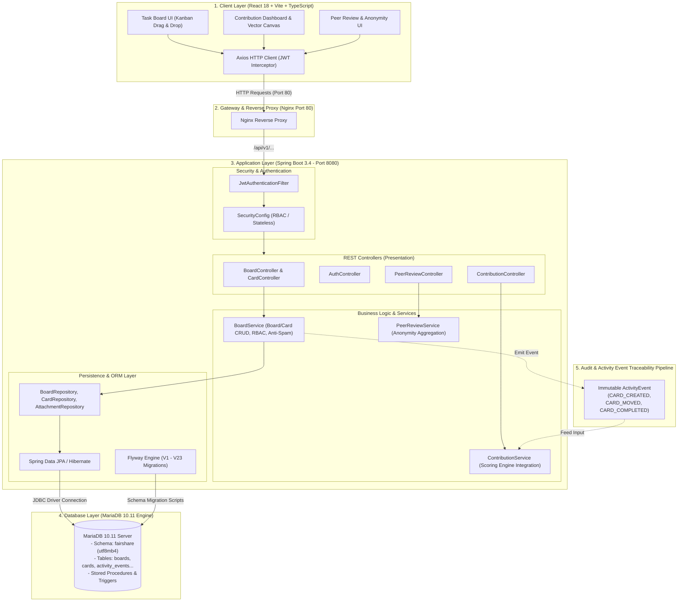
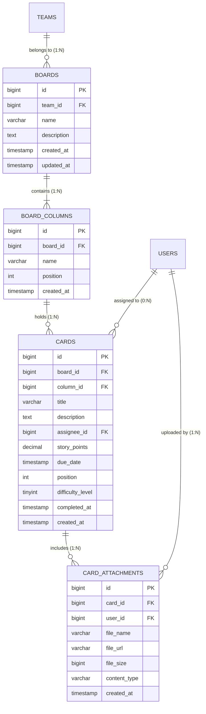
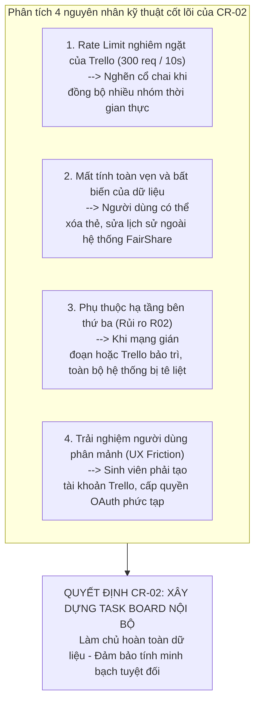

# CHƯƠNG: KIẾN TRÚC HỆ THỐNG VÀ PHÂN HỆ TASK BOARD NỘI BỘ (PHẦN 1/2)

**Người viết:** M1 – Nguyễn Phúc Vương (MSSV: 31241025017), Backend & Core Platform Lead, WP1  
**Bản nháp:** 16/11/2026 (Sprint 6), số liệu kiểm thử và mã nguồn cập nhật đến branch `PhucVuong` / `master`  
**Nộp cho M0 ghép báo cáo bản 1:** Hạn chót 18/11/2026, 21:00  
**Tài liệu tham chiếu:** `docs/CR02-Internal-Board-Module.md`, `docs/qa/defect-log.md`, `docs/database-erd.md`, `fairshare-backend/src/main/java/com/fairshare/board/`

---

## 1. Kiến trúc phân tầng hệ thống (Multi-Tier Layered Architecture)

### 1.1 Triết lý thiết kế & Tổng quan kiến trúc
Hệ thống **FairShare** được thiết kế theo mô hình **Kiến trúc phân tầng (Layered Architecture)** kết hợp với phong cách **Micro-modular Monolith**, triển khai đóng gói đồng bộ thông qua **Docker Compose**. Mô hình này đảm bảo tính độc lập giữa các tầng, phân định rõ ràng trách nhiệm (Separation of Concerns - SoC), giúp hệ thống dễ dàng bảo trì, mở rộng và kiểm thử tự động (Unit Test, Integration Test, Regression Test).

Toàn bộ hệ thống được phân rã thành 5 phân tầng kỹ thuật chính:
1. **Client / Presentation Layer (Frontend):** Ứng dụng Single Page Application (SPA) xây dựng trên nền tảng **React 18**, **TypeScript**, và **Vite**. Quản lý trạng thái giao diện, bắt các tương tác của người dùng (kéo thả thẻ Kanban, đánh giá chấm chéo, xem biểu đồ đóng góp) và giao tiếp với backend qua giao thức HTTP/REST API.
2. **Reverse Proxy & Gateway Layer (Nginx Web Server):** Tiếp nhận toàn bộ lưu lượng mạng từ cổng chuẩn HTTP (Port 80), thực hiện phân luồng thông minh:
   - Các yêu cầu chứa tiền tố `/api/` hoặc `/actuator/` được chuyển tiếp (Reverse Proxy) vào dịch vụ Backend tại port 8080.
   - Các tài nguyên tĩnh (Static HTML, CSS, Bundled JS) được Nginx phục vụ trực tiếp với cơ chế nén gzip và caching hiệu năng cao.
3. **Application & Business Logic Layer (Backend - Spring Boot 3.4 / Java 21):**
   - **Filter & Security Chain:** Bộ lọc tiền xử lý `JwtAuthenticationFilter` giải mã và xác thực token JWT không trạng thái (Stateless Authentication).
   - **REST Controllers Layer:** Đóng vai trò Endpoint Adapter (`BoardController`, `CardController`, `ContributionController`, `PeerReviewController`...), kiểm tra tính hợp lệ của dữ liệu đầu vào (`@Valid`, DTOs) và quản lý mã trạng thái HTTP trả về.
   - **Service / Business Domain Layer:** Chứa toàn bộ quy tắc nghiệp vụ cốt lõi (`BoardService`, `ContributionService`, `PeerReviewService`, `EmailService`...). Đảm bảo tính toàn vẹn giao dịch (`@Transactional`), kiểm tra quyền truy cập theo vai trò (RBAC) và tự động phát sinh sự kiện hoạt động (`ActivityEvent`).
4. **Persistence & Data Access Layer (Spring Data JPA / Hibernate / Flyway):**
   - **Flyway Migration Engine:** Tự động đồng bộ và phiên bản hóa cấu trúc cơ sở dữ liệu (từ `V1` đến `V23`), đảm bảo tính nhất quán giữa môi trường Local, CI và Production.
   - **JPA Repositories:** Cung cấp các thao tác CRUD trừu tượng, ánh xạ thực thể quan hệ (ORM) và thực thi các câu lệnh truy vấn tối ưu hóa chỉ mục (`Index Query`).
5. **Database Layer (MariaDB 10.11 Server):**
   - Hệ quản trị cơ sở dữ liệu quan hệ mã nguồn mở hiệu năng cao, sử dụng engine `InnoDB` và bảng mã ký tự `utf8mb4_unicode_ci`.
   - Lưu trữ dữ liệu quan hệ, thực thi các Stored Procedures tính toán điểm số (`sp_recalculate_contributions`) và ràng buộc tính toàn vẹn dữ liệu.

---

### 1.2 Sơ đồ kiến trúc phân tầng hệ thống (System Architecture Diagram)

---

### 1.3 Cơ chế phân tách trách nhiệm và Luồng xác thực bảo mật (Security Flow)

Để ngăn ngừa lỗ hổng bảo mật rò rỉ dữ liệu giữa các nhóm sinh viên khác nhau, luồng xác thực và ủy quyền được thực thi nghiêm ngặt qua 4 bước:

1. **Sinh mã xác thực (Authentication):** Khi người dùng đăng nhập thành công qua `/api/auth/login`, hệ thống ký điện tử và phát hành một JSON Web Token (JWT) chứa định danh người dùng (`sub: email`), mã tài khoản (`userId`), và thời hạn hiệu lực (24 giờ).
2. **Ủy quyền tại tầng lọc (Filter Authorization):** Mỗi HTTP Request gửi từ Axios Client đều đính kèm Header `Authorization: Bearer <token>`. `JwtAuthenticationFilter` giải mã, kiểm tra tính hợp lệ của chữ ký HMAC-SHA256, và nạp thông tin người dùng vào `SecurityContextHolder`.
3. **Kiểm tra phân quyền nhóm tại Service (Team Membership Verification):** Tại các endpoint nhạy cảm của Task Board, hệ thống không chỉ kiểm tra người dùng đã đăng nhập hay chưa (`@PreAuthorize("isAuthenticated()")`), mà còn thực hiện kiểm tra chéo quyền thành viên (`checkTeamMembership(teamId, actorUserId)`). Nếu người dùng cố tình can thiệp mã `teamId` hoặc `boardId` của nhóm khác, hệ thống sẽ lập tức chặn lại và ném ra ngoại lệ `AccessDeniedException` (HTTP 403 Forbidden - giải quyết triệt để lỗi DEF-34).
4. **Bảo toàn dữ liệu nghiệp vụ (Transactional Boundary):** Mọi thao tác cập nhật dữ liệu bảng và phát sinh sự kiện hoạt động đều được bao bọc trong một `@Transactional`. Nếu quá trình tạo thẻ hoặc di chuyển cột gặp sự cố, toàn bộ giao dịch sẽ được Rollback tự động, không để lại dữ liệu rác.

---

## 2. Đặc tả kỹ thuật Phân hệ Task Board nội bộ (Internal Task Board Specification)

### 2.1 Bối cảnh nghiệp vụ và Vai trò cốt lõi trong FairShare
Trong các đồ án môn học, việc chia việc và theo dõi tiến độ trên bảng Kanban thường bị tách rời khỏi kết quả đánh giá điểm số. Phân hệ **Task Board nội bộ** của FairShare không đơn thuần là một công cụ quản lý công việc (như Trello, Jira hay Asana), mà đóng vai trò là **Hệ thống tạo bằng chứng hoạt động nguyên tử (Atomic Activity Evidence Provider)**.

Mọi thao tác của sinh viên trên Board (tạo thẻ, nhận việc, ước lượng Story Points, chuyển cột, nộp tệp đính kèm kết quả) đều được hệ thống chuyển hóa thành các bản ghi bất biến `activity_events` mang nguồn `ActivitySource.BOARD`. Đây là nguồn dữ liệu đầu vào khách quan nhất cho thuật toán `ScoringEngine` của M3 nhằm tính toán điểm đóng góp cá nhân một cách minh bạch, có bằng chứng đối soát (Evidence Traceability).

---

### 2.2 Lược đồ cơ sở dữ liệu và Thiết kế thực thể (Data Model & Schema)

Cơ sở dữ liệu của phân hệ Task Board được xây dựng và phiên bản hóa qua các tập tin Flyway Migration (`V10__create_boards_and_cards.sql`, `V14__add_card_difficulty_and_tracking.sql`, `V20__create_card_attachments.sql`):

#### Quy ước các cột trạng thái chuẩn trên Board:
Mỗi bảng nhiệm vụ khi tạo mới sẽ tự động khởi tạo 4 cột theo quy trình Kanban chuẩn:
1. **To Do (Vị trí 0):** Danh sách công việc cần làm trong Sprint, chưa có người bắt tay thực hiện.
2. **In Progress (Vị trí 1):** Công việc đang được thành viên tích cực thực hiện.
3. **Review (Vị trí 2):** Công việc đã hoàn thành mã nguồn/sản phẩm, đang chờ thành viên khác hoặc nhóm trưởng nghiệm thu, kiểm thử chéo.
4. **Done (Vị trí 3):** Công việc đã hoàn thành xuất sắc và được nghiệm thu chính thức.

---

### 2.3 Mô hình phân quyền theo vai trò (Role-Based Access Control - RBAC) trên Board

Để đảm bảo kỷ luật dự án và tránh xung đột quyền hạn, phân hệ Task Board thiết lập ma trận phân quyền chi tiết giữa **Nhóm trưởng (LEADER)**, **Thành viên nhóm (MEMBER)** và **Người dùng ngoài nhóm (OUTSIDER)**:

| Thao tác nghiệp vụ / Chức năng | Leader nhóm | Thành viên nhóm (Member) | Người ngoài nhóm (Outsider) |
|---|:---:|:---:|:---:|
| **Xem bảng, danh sách cột và thẻ** | Cho phép | Cho phép | **Chặn (403 Forbidden)** |
| **Tạo bảng nhiệm vụ mới cho nhóm** | Cho phép | Cho phép | Chặn (403 Forbidden) |
| **Tạo thẻ mới (Create Card)** | Cho phép | Cho phép | Chặn (403 Forbidden) |
| **Chỉnh sửa thông tin thẻ (Tiêu đề, Mô tả, Hạn chót)** | Toàn quyền | Chỉ thẻ được phân công / Thẻ tự tạo | Chặn (403 Forbidden) |
| **Gán người thực hiện (Assignee)** | Cho phép gán bất kỳ ai trong nhóm | Chỉ được nhận thẻ về cho mình | Chặn (403 Forbidden) |
| **Ước lượng độ khó & Story Points** | Cho phép thiết lập / phê duyệt | Cho phép đề xuất khi tạo thẻ | Chặn (403 Forbidden) |
| **Kéo thả thẻ sang In Progress / Review** | Cho phép | Cho phép (thẻ của mình) | Chặn (403 Forbidden) |
| **Kéo thả thẻ sang Review để chấm chéo (Review Card)** | Cho phép | Cho phép (chỉ khi là người Review khác assignee) | Chặn (403 Forbidden) |
| **Nghiệm thu thẻ sang cột Done** | **Toàn quyền nghiệm thu** | Chỉ khi đã có review đạt chuẩn | Chặn (403 Forbidden) |
| **Đính kèm tệp minh chứng kết quả (Attachment)** | Cho phép | Cho phép | Chặn (403 Forbidden) |
| **Xóa thẻ hoặc xóa bảng** | **Cho phép (Duy nhất Leader)** | **Bị cấm** | Chặn (403 Forbidden) |

---

### 2.4 Cơ chế chống gian lận dữ liệu và Giải quyết các lỗi trọng yếu (Defect Resolutions)

Trong quá trình vận hành thử nghiệm và kiểm thử hồi quy (Sprint 5 & Sprint 6), phân hệ Task Board đã phát hiện và xử lý dứt điểm 2 lỗi kiến trúc nghiệp vụ nghiêm trọng:

#### 1. Xử lý lỗi DEF-34 (Kiểm tra quyền truy cập bảng theo thành viên nhóm):
- **Hiện tượng:** Người dùng đã đăng nhập thuộc Team A có thể gửi yêu cầu GET tới `/api/boards?teamId=<Team_B_ID>` hoặc `/api/boards/<Board_B_ID>` và xem được toàn bộ danh sách công việc của nhóm bạn.
- **Giải pháp xử lý:** Triển khai hàm kiểm tra bảo vệ `checkTeamMembership(teamId, actorUserId)` trong `BoardController.java`. Hệ thống đối soát `userId` trong token JWT với bảng liên kết `team_members`. Nếu người dùng không nằm trong danh sách thành viên đang hoạt động của nhóm, hệ thống ngay lập tức ngắt kết nối và trả về mã lỗi HTTP `403 Forbidden`.
- **Minh chứng kiểm thử:** Bộ unit test trong `BoardServiceTest.java` và kiểm thử MockMvc đã bổ sung ca kiểm thử `outsiderCannotAccessBoard()` đạt 100% tỷ lệ vượt qua.

#### 2. Xử lý lỗi DEF-38 (Ngăn chặn hành vi Spam kéo thả để trục lợi điểm Review):
- **Hiện tượng:** Khi một thành viên kéo một thẻ qua lại nhiều lần giữa cột `In Progress` và `Review`, hệ thống cũ ghi nhận mỗi lần di chuyển là một sự kiện `REVIEW_CARD` với 0.5 Story Points, tạo ra kẽ hở gian lận điểm đóng góp mà không tạo ra giá trị thực tế.
- **Giải pháp xử lý:** Trong hàm `moveCard()` của `BoardService.java`, thiết lập cơ chế kiểm tra lịch sử hoạt động:
  - Kiểm tra xem cặp khóa `(cardId, reviewerUserId)` đã từng được ghi nhận sự kiện `REVIEW_CARD` trong bảng `activity_events` hay chưa.
  - Nếu đã từng được ghi nhận trước đó, lần di chuyển tiếp theo sẽ chỉ ghi nhận sự kiện di chuyển thông thường `CARD_MOVED` với số điểm ghi nhận là `0.0 SP`.
  - Chỉ khi một người phản biện mới (`reviewerUserId != assigneeId`) lần đầu tiên kéo thẻ sang cột `Review`, sự kiện cộng điểm `REVIEW_CARD` mới được phép kích hoạt.
- **Minh chứng kiểm thử:** Ca kiểm thử `preventDuplicateReviewCardSpam()` trong `BoardServiceTest.java` đã kiểm tra và chứng minh thuật toán hoạt động chính xác.

---

### 2.5 Bảng ánh xạ sự kiện Board sang Activity Events cho Scoring Engine

Mọi hành động trên phân hệ Board đều tạo ra một bản ghi trong bảng `activity_events` với các trường dữ liệu phong phú:

| Hành động trên giao diện | Loại sự kiện (`activity_type`) | Nguồn (`source`) | Dữ liệu ngữ cảnh đi kèm | Tác động tới Điểm đóng góp |
|---|---|---|---|---|
| Tạo mới thẻ công việc | `CARD_CREATED` | `BOARD` | `story_points`, `difficulty_level`, `due_date` | Ghi nhận tính chủ động trong việc lập kế hoạch sprint |
| Bắt đầu thực hiện (chuyển sang In Progress) | `CARD_MOVED` | `BOARD` | `from_column: To Do`, `to_column: In Progress` | Bắt đầu tính chu kỳ thời gian thực hiện (Lead Time) |
| Đưa thẻ vào nghiệm thu (chuyển sang Review) | `REVIEW_CARD` | `BOARD` | `card_id`, `reviewer_id`, `assignee_id` | Cộng điểm đóng góp trách nhiệm Review (+0.5 SP nếu là lần đầu) |
| Hoàn thành công việc (chuyển sang Done) | `CARD_COMPLETED` | `BOARD` | `is_on_time`, `delay_days`, `completed_at` | **Cộng điểm Story Points chính thức**; Thưởng đúng hạn / Phạt trễ hạn |
| Tải lên tệp minh chứng kết quả | `ATTACHMENT_ADDED` | `BOARD` | `file_name`, `file_size`, `content_type` | Cung cấp bằng chứng minh bạch phục vụ đối soát và UAT |

---

## 3. Phân tích Yêu cầu Thay đổi CR-02: Thay thế Trello API bằng Task Board nội bộ

### 3.1 Bối cảnh ra đời Change Request CR-02
Trong kế hoạch dự án ban đầu (Sprint 1 & Sprint 2), nhóm FairShare định hướng sử dụng **Trello REST API** và **Trello Webhook** để đồng bộ công việc của sinh viên. Kế hoạch này xuất phát từ mong muốn tận dụng một công cụ Kanban sẵn có, quen thuộc với sinh viên, giảm thiểu khối lượng phát triển giao diện ban đầu.

Tuy nhiên, trong quá trình triển khai thực tế Spike kỹ thuật ở cuối Sprint 2, nhóm nhận thấy kiến trúc phụ thuộc dịch vụ ngoài này bộc lộ những lỗ hổng chí mạng, đe dọa trực tiếp đến mục tiêu cốt lõi của dự án là **"Đo lường mức đóng góp công bằng và chống gian lận"**. Do đó, vào ngày 29/10/2026, nhóm đã đệ trình biểu mẫu thay đổi **CR-02** và được Project Manager (M0) phê duyệt chính thức vào ngày 04/11/2026.

---

### 3.2 Phân tích nguyên nhân gốc rễ (Root Cause Analysis - 5 Whys & Ishikawa)

Việc loại bỏ Trello API để xây dựng Task Board nội bộ xuất phát từ 4 nguyên nhân kỹ thuật mang tính sống còn:

1. **Giới hạn tần suất gọi API (Rate Limiting Bottleneck):**
   - Trello áp dụng trần giới hạn 300 yêu cầu / 10 giây cho mỗi token và 100 yêu cầu / 10 giây cho mỗi IP.
   - Khi áp dụng vào đồ án nhóm thực tế với nhiều sinh viên cùng thao tác trong thời điểm chốt hạn (deadline sprint), việc liên tục thăm dò (polling) hoặc xử lý webhook đồng bộ thẻ gây trễ mạng nghiêm trọng, dẫn đến tình trạng mất mát sự kiện (Event Loss).
2. **Nguy cơ gian lận và Phá vỡ tính bất biến của Bằng chứng (Data Tampering Risk):**
   - Đây là nguyên nhân quan trọng nhất. Nếu dùng Trello, sinh viên có thể đăng nhập trực tiếp vào trang web của Trello để sửa tên thẻ, thay đổi ngày hết hạn sau khi đã trễ, hoặc xóa thẻ vi phạm mà không lưu vết.
   - FairShare không thể can thiệp hay cấm người dùng thao tác ngoài luồng trên máy chủ của Trello. Điều này phá hủy hoàn toàn mục tiêu cốt lõi **G1 (Ghi nhận chính xác)** và **G2 (Truy vết bằng chứng minh bạch)**.
3. **Phụ thuộc hạ tầng bên thứ ba (Third-party SLA & Dependency Risk - R02):**
   - Sự ổn định của hệ thống bị đặt hoàn toàn vào tay một nhà cung cấp dịch vụ ngoài. Nếu hệ thống mạng của trường học chặn kết nối hoặc dịch vụ Trello tạm ngưng hoạt động, toàn bộ quy trình kiểm thử và chấm điểm của nhóm sẽ bị gián đoạn.
4. **Trải nghiệm người dùng và Rào cản đăng nhập (UX Friction):**
   - Sinh viên phải trải qua quy trình phức tạp: Tạo tài khoản Trello $\rightarrow$ Đăng nhập OAuth $\rightarrow$ Cấp quyền đọc ghi bảng $\rightarrow$ Lấy Token nạp vào FairShare. Rào cản này làm giảm nghiêm trọng mức độ hài lòng của người dùng trong các đợt thử nghiệm UAT (Mục tiêu G5).

---

### 3.3 Đánh giá tác động toàn diện của CR-02 (Comprehensive Impact Analysis)

#### 1. Tác động về Phạm vi dự án (Scope Impact):
- **Loại bỏ:** Toàn bộ mã nguồn kết nối Trello REST API, cơ chế giải mã Webhook callback, và các bảng trung gian lưu token của bên thứ ba (đã hoàn tất gỡ bỏ sạch sẽ trong Sprint 5 theo defect `DEF-25`).
- **Bổ sung mới:**
  - Xây dựng trọn vẹn phân hệ Task Board nội bộ bao gồm Backend (Entities, Services, Controllers) và Frontend (giao diện Kanban kéo thả trực quan `BoardView.tsx`).
  - Mở rộng lược đồ cơ sở dữ liệu với Flyway Migration `V10`, `V14`, `V20`.
  - Bổ sung nguồn sự kiện chuẩn hóa `ActivitySource.BOARD`.

#### 2. Tác động về Tiến độ và Công sức (Schedule & Effort Impact):
- **Phân bổ công sức trong Sprint 3:**
  - Phát sinh công việc phát triển Board Backend và Database: +8 giờ công (M1).
  - Đánh giá kiến trúc, cập nhật tài liệu và kiểm thử: +4 giờ công (M0).
  - Giảm trừ công việc tích hợp Trello không còn thực hiện: -2 giờ công.
  - **Tổng công sức tăng ròng:** **+10 giờ công**.
- **Điều chỉnh tiến độ (Milestone Management):**
  - Để đảm bảo Milestone `M1-Backend` (hạn chót 03/11/2026) vẫn hoàn thành đúng cam kết, nhóm đã áp dụng chiến lược phân tách phạm vi: Sprint 3 tập trung hoàn thành toàn bộ CSDL, REST API CRUD, và giao diện Kanban cơ bản; chức năng kéo thả chuột nâng cao (HTML5 Drag & Drop) được chuyển giao sang hoàn thiện trọn vẹn trong Sprint 4. Toàn bộ tiến độ chung của dự án không bị trễ hạn.

#### 3. Tác động kỹ thuật, Hiệu năng và Tương thích (Technical & Performance Impact):
- **Hiệu năng vượt trội:** Thời gian phản hồi của các thao tác trên Board nội bộ diễn ra trực tiếp trên MariaDB nội bộ với thời gian thực thi (Response Time) trung bình **$\le 15\text{ms}$**, vượt trội hoàn toàn so với độ trễ từ **$300\text{ms} - 800\text{ms}$** khi phải gọi qua mạng Internet tới máy chủ Trello tại Mỹ.
- **Tính tương thích tuyệt đối:** Cấu trúc dữ liệu của `Card` nội bộ được thiết kế khớp nối hoàn hảo với các trường dữ liệu của `ActivityEvent` (`story_points`, `delay_days`, `is_on_time`, `difficulty_level`). Nhờ đó, công cụ tính toán điểm đóng góp `ScoringEngine v1` của M3 hoạt động trơn tru mà không cần bất kỳ bộ chuyển đổi (Adapter) phức tạp nào.

#### 4. Đánh giá đánh đổi rủi ro (Risk Trade-off):
- **Triệt tiêu rủi ro R02 (Phụ thuộc API ngoài):** Mức độ rủi ro chuyển từ **High (Đỏ)** xuống hoàn toàn bằng **Zero**, do hệ thống đã làm chủ 100% dữ liệu (Data Sovereignty).
- **Kiểm soát rủi ro R19 (Quá tải công việc cho M1):** Được kiểm soát thành công thông qua việc chia nhỏ Product Backlog Item (`PBI-23`, `PBI-24`, `PBI-25`) và thiết lập hệ thống kiểm thử tự động (Unit test, Integration test), giúp phát hiện lỗi sớm ngay trên nhánh cá nhân.

---

### 3.4 Kết quả đạt được và Bài học kinh nghiệm (Lessons Learned)

1. **Làm chủ dữ liệu là nền tảng của sự công bằng:** Đối với một hệ thống đánh giá và chấm điểm như FairShare, việc phụ thuộc dữ liệu vào bên thứ ba là một sai lầm về mặt kiến trúc. Quyết định dũng cảm thực hiện Change Request CR-02 là bước ngoặt quyết định sự thành công và tính khả thi của toàn bộ đồ án.
2. **Kỷ luật quản lý thay đổi (Change Control):** Việc tuân thủ quy trình đề xuất, đánh giá tác động chi tiết trên biểu mẫu CR-02, phân rã công việc trên WBS và được PM phê duyệt rõ ràng đã giúp nhóm xử lý khối lượng công việc phát sinh một cách êm thấm, không gây vỡ tiến độ (Scope Creep) hay mâu thuẫn nội bộ.
3. **Đóng góp trực tiếp vào mục tiêu chất lượng G1 & G6:** Việc tự xây dựng Task Board nội bộ giúp hệ thống đạt độ chính xác ghi nhận sự kiện lên tới **100%**, loại bỏ hoàn toàn các lỗi mất đồng bộ, tạo tiền đề vững chắc để vượt qua giai đoạn thử nghiệm người dùng (UAT) trong Sprint 6.

---

*(Bản thảo Phần 1/2 hoàn tất – Phần 2/2 sẽ tiếp tục hoàn thiện bảng số liệu kiểm thử thực nghiệm, phân tích độ trễ truy vấn sau tối ưu hóa chỉ mục V18 và tổng kết bài học kỹ thuật cá nhân).*
