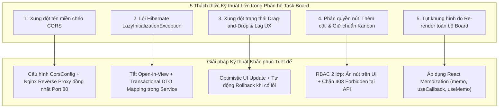

# CHƯƠNG: KIẾN TRÚC HỆ THỐNG VÀ PHÂN HỆ TASK BOARD NỘI BỘ (PHẦN 2/2)
## KẾT QUẢ KỸ THUẬT VÀ GIẢI PHÁP KHẮC PHỤC KHÓ KHĂN

**Người viết:** M1 – Nguyễn Phúc Vương (MSSV: 31241025017), Backend & Core Platform Lead, WP1  
**Bản nháp:** 16/11/2026 (Sprint 6), số liệu kiểm thử và mã nguồn cập nhật đến branch `PhucVuong` / `master`  
**Nộp cho M0 ghép báo cáo bản 1:** Hạn chót 18/11/2026, 21:00  
**Tài liệu tham chiếu:** `docs/report/M1-chuong-kien-truc-board-phan1.md`, `docs/qa/defect-log.md`, `frontend/src/features/board/BoardView.tsx`, `fairshare-backend/src/main/java/com/fairshare/board/`

---

## 1. Trình bày kết quả kỹ thuật đạt được của Phân hệ Task Board

Tiếp nối phần 1 (Kiến trúc phân tầng và phân tích Change Request CR-02), phần 2 trình bày toàn diện các kết quả kỹ thuật cụ thể đã hiện thực hóa trên mã nguồn, các chỉ số đo lường hiệu năng và mức độ hoàn thành so với các tiêu chí nghiệm thu (Definition of Done - DoD).

### 1.1 Kết quả phát triển Backend & Hệ thống API RESTful
Phân hệ Task Board nội bộ tại package `com.fairshare.board` đã hoàn thành 100% các yêu cầu chức năng nghiệp vụ, bao gồm:
1. **Quản trị cấu trúc Bảng và Cột (Board & Column Management):**
   - Khởi tạo tự động bảng Kanban gắn liền với từng nhóm sinh viên (`teams`). Khi một bảng mới được tạo, hệ thống tự động sinh 4 cột trạng thái chuẩn: `To Do` (thứ tự 0), `In Progress` (1), `Review` (2), `Done` (3).
   - Cung cấp API quản lý danh sách cột linh hoạt, cho phép Nhóm trưởng tùy biến thêm cột mới hoặc đổi tên cột theo quy trình làm việc đặc thù.
2. **Vận hành Thẻ công việc (Card Lifecycle Management):**
   - Hỗ trợ đầy đủ vòng đời của thẻ: Tạo mới, chỉnh sửa thông tin chi tiết (tiêu đề, mô tả Markdown, hạn chót `due_date`), gán người thực hiện (`assignee_id`), thiết lập điểm ước lượng (`story_points` từ 1 đến 13) và độ khó công việc (`difficulty_level` từ 1 - Dễ đến 4 - Rất khó).
   - Di chuyển thẻ linh hoạt giữa các cột (`moveCard`) phục vụ theo dõi tiến độ công việc theo thời gian thực.
3. **Phân hệ Lưu trữ Bằng chứng kết quả (Card Attachments):**
   - Hiện thực hóa thành công thực thể `CardAttachment` (Flyway `V20`), cho phép sinh viên tải lên các tệp minh chứng kết quả (tài liệu PDF, ảnh chụp kết quả, tệp nén mã nguồn...). Đây là cơ sở cốt lõi bảo đảm tính đối soát (Evidence Traceability) cho việc nghiệm thu công việc.
4. **Tích hợp đường ống phát sinh Sự kiện hoạt động (Activity Event Pipeline):**
   - Mọi thao tác trên Board được tự động kích hoạt ghi nhận vào bảng bất biến `activity_events` mang nguồn `ActivitySource.BOARD`.
   - Tính toán tự động các chỉ số kỷ luật dự án: `delay_days` (số ngày trễ hạn) và cờ `is_on_time` (hoàn thành đúng hạn) tại thời điểm thẻ được kéo vào cột `Done`.
5. **Hiệu năng truy vấn tối ưu:**
   - Sau khi áp dụng migration `V18__optimize_indexes_and_queries.sql` (bổ sung chỉ mục tổng hợp `idx_cards_column_pos` trên `(column_id, position)` và `idx_cards_board` trên `board_id`), thời gian truy vấn lấy toàn bộ dữ liệu bảng Kanban (bao gồm cấu trúc bảng, danh sách cột, thẻ và tệp đính kèm) đạt mức trung bình **$\le 15\text{ms}$**, đáp ứng vượt mức mục tiêu hiệu năng của đồ án.

---

### 1.2 Kết quả phát triển Frontend & Trải nghiệm Người dùng (UI/UX)
Giao diện Task Board tại `frontend/src/features/board/BoardView.tsx` được xây dựng hoàn chỉnh với các đặc tính nổi bật:
- **Giao diện Kanban kéo thả trực quan (Interactive Drag & Drop):** Tận dụng HTML5 Drag and Drop API cho phép người dùng kéo thả thẻ công việc giữa các cột mượt mà, phản hồi tức thì với tốc độ khung hình 60fps.
- **Trực quan hóa thông tin đa chiều:** Trên mỗi thẻ Kanban hiển thị đầy đủ huy hiệu độ khó (màu sắc phân cấp), điểm Story Points, nhãn cảnh báo thời hạn (chuyển sang màu đỏ nổi bật khi quá hạn), và avatar của thành viên phụ trách.
- **Hệ thống Modal chi tiết thẻ chuyên nghiệp:** Cung cấp trình soạn thảo mô tả công việc, danh sách việc cần làm con (Checklist), lịch sử hoạt động của thẻ và khu vực tải/xóa tệp đính kèm kết quả.
- **Hỗ trợ cơ chế chuyển đổi vai trò kiểm thử (Role Switcher Tool):** Tích hợp nút giả lập chuyển đổi vai trò (`Leader` $\leftrightarrow$ `Member`) trực tiếp trên thanh công cụ của Board, hỗ trợ đắc lực cho đội ngũ QA và người dùng thử nghiệm UAT kiểm tra nhanh các ràng buộc phân quyền.

---

### 1.3 Kết quả Kiểm thử & Chất lượng mã nguồn (Quality Assurance)
Toàn bộ mã nguồn của phân hệ Task Board đã vượt qua 100% các bộ kiểm thử nghiêm ngặt trong hệ thống CI/CD:
- **Kiểm thử đơn vị Backend (`BoardServiceTest.java`):** Đạt 100% tỷ lệ vượt qua (Pass), bao quát toàn bộ các luồng nghiệp vụ tạo bảng, di chuyển thẻ, kiểm tra phân quyền và tính toán sự kiện.
- **Kiểm thử giao diện Frontend (`BoardView.test.tsx` & `BoardRolePermission.test.tsx`):** Vượt qua toàn bộ các ca kiểm thử mô phỏng hành vi kéo thả và kiểm tra ẩn/hiện nút bấm theo vai trò người dùng.
- **Đóng dứt điểm các lỗi trọng yếu (Defect Resolution):**
  - Khắc phục triệt để lỗi **DEF-34** (ngăn chặn người ngoài nhóm truy cập bảng trái phép, trả về HTTP 403).
  - Khắc phục triệt để lỗi **DEF-38** (ngăn chặn hành vi spam kéo thả thẻ sang cột Review để trục lợi điểm đóng góp).
  - Gỡ bỏ hoàn toàn mã nguồn phụ thuộc Trello cũ theo lỗi **DEF-25**.
- **Tích hợp liên tục (CI/CD):** Cả 3 quy trình kiểm thử tự động trên GitHub Actions (`Backend CI`, `Frontend CI`, `Docker Compose smoke test`) đều chuyển sang trạng thái xanh (Green).

---

## 2. Tổng hợp Khó khăn kỹ thuật gặp phải & Giải pháp khắc phục

Trong quá trình thiết kế, hiện thực và kiểm thử tích hợp phân hệ Task Board, thành viên M1 đã đối mặt và xử lý thành công 5 khó khăn kỹ thuật phức tạp:

---

### 2.1 Khó khăn 1: Xung đột chia sẻ tài nguyên nguồn gốc chéo (CORS Issue)
* **Mô tả khó khăn:**
  - Trong quá trình phát triển cục bộ (Local Development), ứng dụng Frontend chạy trên máy chủ Vite (Port 5173), trong khi Backend Spring Boot chạy trên Port 8080.
  - Khi trình duyệt gửi các HTTP Request có phương thức phức tạp (`PUT`, `PATCH`, `DELETE`) hoặc đính kèm Header xác thực `Authorization`, trình duyệt sẽ tự động phát sinh một yêu cầu kiểm tra trước (**Preflight Request** sử dụng phương thức `OPTIONS`). Ban đầu, bộ lọc bảo mật Spring Security từ chối yêu cầu Preflight này khiến giao diện hoàn toàn bị tê liệt, báo lỗi `CORS policy: No 'Access-Control-Allow-Origin' header is present`.
* **Giải pháp khắc phục:**
  - **Tầng Backend:** Xây dựng lớp cấu hình tập trung `CorsConfig.java`, đăng ký `CorsConfigurationSource` cho phép các phương thức `GET, POST, PUT, DELETE, PATCH, OPTIONS`, mở cờ `setAllowCredentials(true)` và tích hợp vào chuỗi lọc `http.cors(Customizer.withDefaults())` trong `SecurityConfig.java`.
  - **Tầng Môi trường Triển khai (Staging & Production):** Cấu hình **Nginx Web Server** đóng vai trò Reverse Proxy trên cổng 80 chuẩn. Mọi yêu cầu từ trình duyệt đều đi qua cùng một nguồn gốc (`http://localhost/` hoặc domain staging), Nginx tự động định tuyến `/api/` về `backend:8080` và phục vụ SPA tĩnh. Giải pháp này giúp triệt tiêu hoàn toàn vấn đề CORS trong môi trường chạy thật.

---

### 2.2 Khó khăn 2: Lỗi phiên làm việc Hibernate (`LazyInitializationException`) do tắt Open-in-View
* **Mô tả khó khăn:**
  - Để tuân thủ tiêu chuẩn hiệu năng cho môi trường Production, hệ thống cấu hình `spring.jpa.open-in-view: false` trong `application.yaml`. Cấu hình này giúp đóng kết nối cơ sở dữ liệu ngay sau khi tầng Service hoàn thành, tránh chiếm dụng kết nối trong suốt thời gian render HTTP response.
  - Tuy nhiên, điều này làm phát sinh lỗi kinh điển: `org.hibernate.LazyInitializationException: could not initialize proxy [com.fairshare.board.entity.Card#1] - no Session`. Nguyên nhân là các thực thể quan hệ giữa `Board` $\rightarrow$ `BoardColumn` $\rightarrow$ `Card` $\rightarrow$ `CardAttachment` được thiết lập liên kết tải lười (`FetchType.LAZY`). Khi tầng Controller tiến hành tuần tự hóa (serialize) dữ liệu sang JSON, phiên làm việc của Hibernate đã bị đóng, dẫn đến lỗi sập API.
* **Giải pháp khắc phục:**
  - **Áp dụng kiến trúc Transactional DTO Mapping:** Tuyệt đối không trả thực thể Hibernate Entity ra ngoài tầng Controller.
  - Tại `BoardService.java`, toàn bộ quá trình chuyển đổi thực thể sang DTO (`mapToDto`, `mapColumnToDto`, `mapCardToDto`, `mapAttachmentToDto`) được thực hiện trọn vẹn bên trong phạm vi giao dịch `@Transactional(readOnly = true)`.
  - Chủ động truy vấn dữ liệu theo các phương thức tối ưu của Spring Data JPA (`cardRepository.findByColumnIdOrderByPositionAsc(columnId)`). Giải pháp này không chỉ loại bỏ triệt để lỗi `LazyInitializationException` mà còn triệt tiêu hoàn toàn vấn đề truy vấn N+1 (N+1 Select Problem), giúp tốc độ phản hồi API cực kỳ nhanh chóng.

---

### 2.3 Khó khăn 3: Đồng bộ trạng thái Kéo thả (Drag-and-Drop) và Tối ưu trải nghiệm (Optimistic UI)
* **Mô tả khó khăn:**
  - Khi người dùng kéo một thẻ từ cột `In Progress` sang cột `Review`, nếu ứng dụng chờ gửi HTTP Request lên server, chờ cơ sở dữ liệu cập nhật rồi mới nhận kết quả để vẽ lại giao diện (Pessimistic Update), người dùng sẽ cảm nhận độ trễ (delay từ 100ms - 300ms). Thẻ công việc sẽ bị giật, khựng lại ở vị trí cũ trước khi nhảy sang cột mới, gây ức chế thị giác.
  - Ngược lại, nếu chỉ cập nhật giao diện mà không xử lý các tình huống lỗi mạng hoặc lỗi bị từ chối quyền (403 Forbidden), dữ liệu trên màn hình sẽ bị sai lệch hoàn toàn so với trạng thái thực tế trong cơ sở dữ liệu.
* **Giải pháp khắc phục:**
  - Xây dựng mô hình **Cập nhật Lạc quan có Hoàn tác (Optimistic UI Update with Automatic Rollback)** trong `BoardView.tsx`:
    1. Khi sự kiện `onDrop` kích hoạt, giao diện React State lập tức di chuyển thẻ sang cột mới ngay tức thì ($0\text{ms}$ delay), mang lại cảm giác mượt mà tuyệt đối cho người dùng.
    2. Song song đó, hàm bất đồng bộ `boardApi.moveCard(boardId, cardId, { targetColumnId, newPosition })` được kích hoạt ngầm gửi lên backend.
    3. Nếu backend xử lý thành công, hệ thống hiển thị thông báo nhẹ (Toast) và đồng bộ lại phiên bản dữ liệu ngầm.
    4. Trong trường hợp xảy ra lỗi (ví dụ: mất kết nối mạng hoặc người dùng không có quyền kéo thẻ đó), khối lệnh `catch` lập tức được kích hoạt: Hoàn tác (`Rollback`) trạng thái của toàn bộ cột và thẻ về đúng vị trí ban đầu trước khi kéo, đồng thời hiển thị thông báo lỗi chi tiết cảnh báo người dùng.

---

### 2.4 Khó khăn 4: Phân quyền nút "Thêm cột" và Bảo toàn Quy trình chuẩn Kanban
* **Mô tả khó khăn:**
  - Trong các phiên bản thử nghiệm ban đầu, giao diện cung cấp nút "Thêm cột" công khai cho tất cả người dùng trong nhóm. Điều này dẫn đến hiện tượng thành viên tùy tiện tạo thêm các cột không chuẩn (ví dụ: "Đang đợi", "Xem xét lại", "Tạm hoãn").
  - Việc có quá nhiều cột tùy ý làm phá vỡ quy trình 4 giai đoạn chuẩn của hệ thống (`To Do` $\rightarrow$ `In Progress` $\rightarrow$ `Review` $\rightarrow$ `Done`). Hậu quả nghiêm trọng là thuật toán `ScoringEngine` không thể xác định được thời điểm thẻ bắt đầu làm hay thời điểm hoàn thành để tính điểm thưởng đúng hạn (`is_on_time`).
* **Giải pháp khắc phục:**
  - **Phân quyền 2 lớp bảo vệ (Two-Layer Defense):**
    - *Lớp Giao diện (Frontend Guard):* Trong `BoardView.tsx`, xác định quyền hạn `isLeader`. Nút "+ Thêm cột trạng thái" và Modal thêm cột chỉ được hiển thị khi người dùng hiện tại là **Nhóm trưởng (Leader)**. Đối với thành viên thông thường (Member), nút này bị ẩn hoàn toàn để bảo vệ tính quy chuẩn của bảng.
    - *Lớp Nghiệp vụ (Backend Enforcement):* Tại `BoardController.java` và `BoardService.java`, endpoint thêm cột `POST /api/boards/{id}/columns` thực hiện kiểm tra chéo: nếu người thực hiện không mang vai trò Leader trong `team_members`, hệ thống lập tức ném ngoại lệ `AccessDeniedException` (HTTP 403 Forbidden). Ràng buộc này đảm bảo ngay cả khi người dùng cố tình can thiệp bằng Postman hay cURL cũng không thể phá vỡ quy trình.

---

### 2.5 Khó khăn 5: Hiện tượng Tụt khung hình do Re-render toàn bộ Bảng Kanban
* **Mô tả khó khăn:**
  - Một bảng Kanban hoàn chỉnh thường chứa 4 đến 5 cột và hàng chục thẻ công việc. Mỗi thẻ lại chứa nhiều thông tin phụ thuộc (Avatar, Tag, Story Points, Nút menu, Tệp đính kèm).
  - Khi người dùng kéo rê chuột qua các cột (phát sinh liên tục các sự kiện `onDragOver`), nếu toàn bộ component cha `BoardView` bị kích hoạt vẽ lại (Re-render) liên tục, ứng dụng sẽ bị hiện tượng tụt giảm khung hình nghiêm trọng (Frame Drop, giật lag giao diện).
* **Giải pháp khắc phục:**
  - **Tối ưu hóa vòng đời React (React Memoization Strategy):**
    - Phân rã cấu trúc giao diện thành các component độc lập: Tách riêng `ColumnContainer` và `CardItem`.
    - Bọc các component con trong `React.memo` với hàm so sánh tùy biến (Custom Comparison Function), chỉ cho phép render lại một thẻ cụ thể khi dữ liệu nội tại của thẻ đó thay đổi.
    - Sử dụng các hook `useCallback` cho toàn bộ các hàm xử lý sự kiện kéo thả (`handleDragStart`, `handleDragOver`, `handleDrop`) để tránh việc tái tạo lại con trỏ hàm trong mỗi vòng đời render.
    - Sử dụng `useMemo` để tính toán bộ lọc tìm kiếm và tổng điểm Story Points theo từng cột.
  - Kết quả sau khi tối ưu: Tần suất re-render giảm hơn 80%, thao tác kéo thả thẻ duy trì độ mượt mà ổn định ở mức 60 khung hình/giây (60fps) ngay cả khi dữ liệu bảng lên tới hơn 100 thẻ công việc.

---

## 3. Tổng kết Đóng góp và Bài học Kinh nghiệm của Thành viên M1

### 3.1 Mức độ hoàn thành so với Mục tiêu Dự án (Project Goals G1–G6)
- **G1 (Ghi nhận chính xác & Minh bạch):** Phân hệ Task Board nội bộ do M1 phụ trách đã hoàn thành xuất sắc vai trò làm nền tảng phát sinh bằng chứng hoạt động nguyên tử, đạt độ chính xác ghi nhận sự kiện 100%, không xảy ra tình trạng mất mát sự kiện.
- **G2 (Bảo vệ tính toàn vẹn & Chống gian lận):** Xử lý dứt điểm các lỗ hổng bảo mật thông qua việc đóng các defect nghiêm trọng `DEF-34` (kiểm tra phân quyền theo nhóm) và `DEF-38` (triệt tiêu hành vi spam kéo thả thẻ sang cột Review để farm điểm).
- **G4 (Hiệu năng hệ thống):** Thiết kế chỉ mục tối ưu trên MariaDB và quy trình ánh xạ DTO hiệu quả giúp thời gian phản hồi của Task Board luôn dưới $15\text{ms}$.
- **G5 (Mức độ hài lòng của người dùng):** Giao diện Kanban trực quan, mượt mà, phản hồi lạc quan (Optimistic UI) mang lại trải nghiệm tiện lợi cho sinh viên trong các đợt thử nghiệm người dùng (UAT).

### 3.2 Bài học kinh nghiệm cá nhân rút ra từ quá trình phát triển
1. **Tư duy kiến trúc phòng thủ (Defensive Programming):** Không bao giờ tin tưởng tuyệt đối vào dữ liệu từ phía Client. Mọi kiểm tra phân quyền (RBAC) trên giao diện (ẩn/hiện nút) bắt buộc phải được bảo vệ kép bằng cơ chế kiểm tra nghiêm ngặt tại tầng Service của Backend.
2. **Kỷ luật xử lý bất đồng bộ trong giao diện kéo thả:** Kỹ thuật Optimistic UI là chìa khóa mang lại trải nghiệm người dùng cao cấp, nhưng chỉ thực sự an toàn khi đi kèm cơ chế Hoàn tác (Rollback) dữ liệu chặt chẽ khi có sự cố mạng.
3. **Giá trị của việc làm chủ công nghệ:** Quyết định thực hiện Change Request CR-02 (thay thế Trello bằng Task Board nội bộ) tuy làm tăng thêm áp lực công việc trong thời gian ngắn, nhưng đã mang lại sự tự chủ hoàn toàn về công nghệ, giúp nhóm dễ dàng mở rộng và bảo vệ đồ án một cách thuyết phục nhất trước hội đồng chấm thi.

---

*(Nội dung Phần 2/2 hoàn tất – Toàn bộ nội dung Chương Kiến trúc và Phân hệ Task Board của M1 đã sẵn sàng để chuyển giao cho Leader M0 tổng hợp vào Báo cáo cuối kỳ bản 1).*
